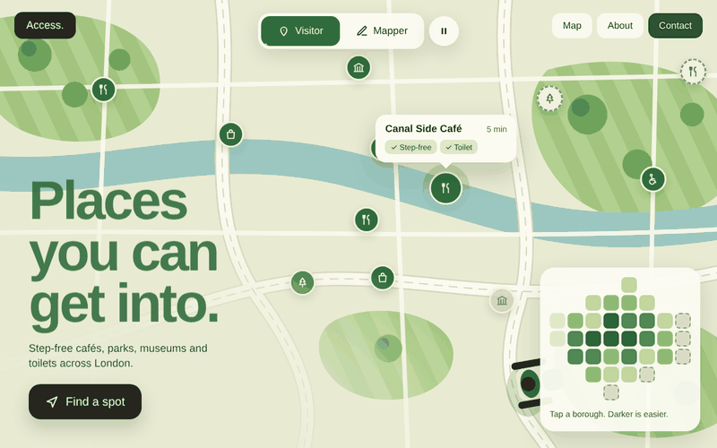
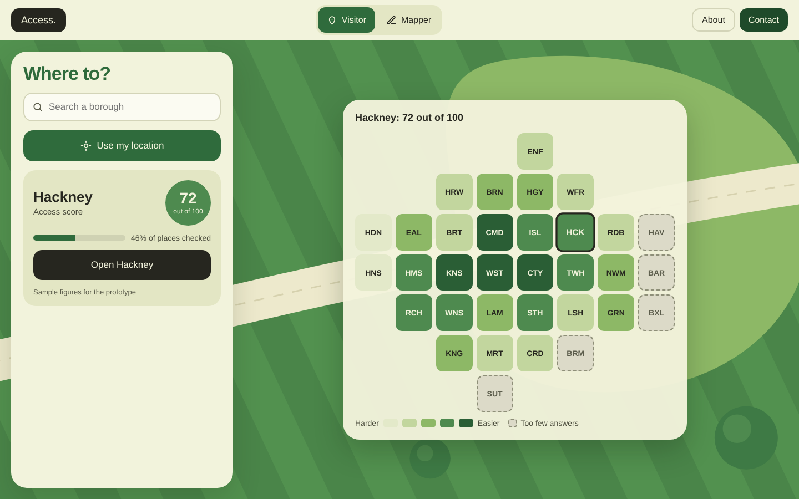
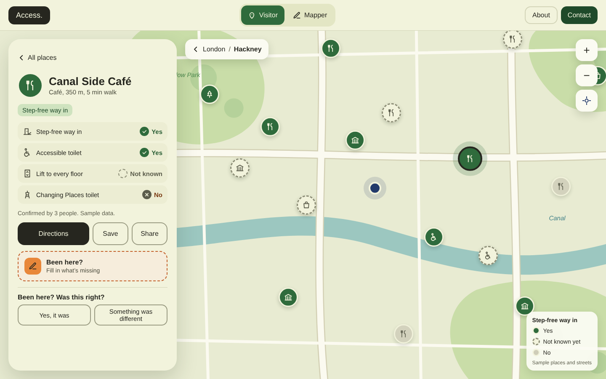
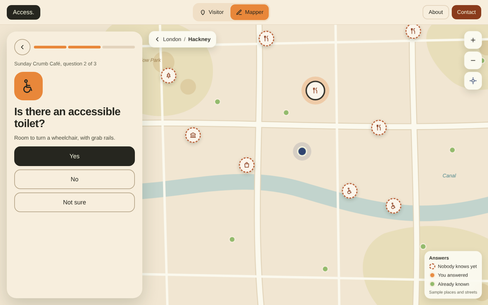
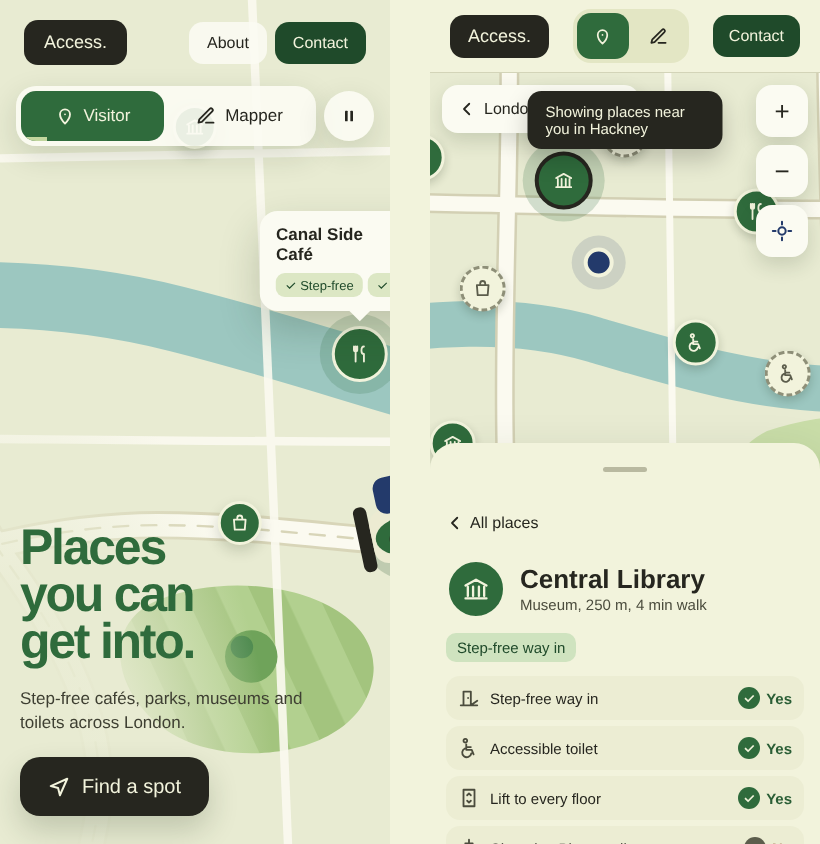
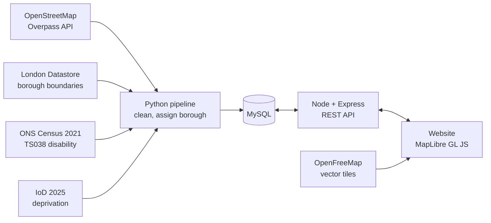

# Access London
**Find places you can actually get into. Help someone else get in.**

Access London is a web map of places across London that wheelchair users can get into: cafés, parks, museums, shops and public toilets. Anyone who has been to a place can fill in what's missing by answering three quick questions. No account is needed.

**The research problem:** most places on the map say nothing about access. We ask *is accessibility information missing where disabled Londoners live?* The site shows what is known for each of the 33 boroughs, says clearly what is not, and compares the gaps with the share of disabled residents (Census 2021) and deprivation (English Indices of Deprivation 2025).

Built by **The DOMinators** for CASA0017 Web Architecture, UCL Centre for Advanced Spatial Analysis.

**Live site:** _coming soon_



---

## What the website does

The home page is the map. It switches every four seconds between the two ways to use the site, until you pick one.

| | Visitor (green) | Mapper (orange) |
|---|---|---|
| Who | Wheelchair users, carers, friends planning a trip | Anyone who has been somewhere |
| Does | Chooses what they need, sees places that have it, checks a place before going | Picks a place nobody has checked and answers three questions |
| Sees | Yes, no or **not known** for each need, and how many people confirmed it | Places missing answers, then the difference their answer made |

A dashed ring always means **not known**. The site never shows "not known" as "no".

| Borough tiles | A place, checked before going |
|---|---|
|  |  |

| Mapper question | On a phone |
|---|---|
|  |  |

### Features

- **Borough tile map** of all 33 boroughs, coloured by access score (visitor) or by share of places with no answer (mapper)
- **Street map per borough** filtered by need: step-free way in, accessible toilet, lift to every floor, Changing Places toilet
- **Place card** with a checklist, confirmations, directions, save and share
- **Mapper flow**: confirm the place, then up to three questions, one per screen, with "Not sure" always allowed
- **Two people must agree** before a crowd answer counts towards the map and the score
- **Reports and suggested places**, reviewed before they change anything
- **About page** with the scoring method, a gaps chart, data sources and limits
- **Contact form** and an accessibility statement
- Works on phone and desktop, with a keyboard alone, with screen readers and with reduced motion

## Built with

| Layer | Tools |
|---|---|
| Map | [MapLibre GL JS](https://maplibre.org) with vector tiles from [OpenFreeMap](https://openfreemap.org), styled in [Maputnik](https://maplibre.org/maputnik/) |
| Charts | [Apache ECharts](https://echarts.apache.org) |
| Website | HTML, CSS and JavaScript, [Outfit](https://fonts.google.com/specimen/Outfit) typeface |
| API | [Node.js](https://nodejs.org) and [Express](https://expressjs.com) |
| Database | [MySQL](https://www.mysql.com) |
| Data pipeline | [Python](https://www.python.org), [GeoPandas](https://geopandas.org), [Shapely](https://shapely.readthedocs.io) |
| Data | [OpenStreetMap](https://www.openstreetmap.org) via the [Overpass API](https://wiki.openstreetmap.org/wiki/Overpass_API), [London Datastore](https://data.london.gov.uk), [ONS Census 2021 TS038](https://www.ons.gov.uk/datasets/TS038), [English Indices of Deprivation 2025](https://www.gov.uk/government/statistics/english-indices-of-deprivation-2025) |

## How it works



1. **Collect:** one Overpass query fetches London places and their `wheelchair` and `toilets:wheelchair` tags. It runs at most once a day and the result is saved; the website never calls Overpass directly.
2. **Clean:** Python reprojects borough boundaries from British National Grid (EPSG:27700) to WGS84 (EPSG:4326) and assigns each place to a borough.
3. **Store:** MySQL holds places, their access values, crowd answers, reports and messages.
4. **Serve:** an Express API returns JSON and GeoJSON.
5. **Show:** MapLibre draws OpenFreeMap vector tiles restyled to our palette, with our GeoJSON layers on top.

**Scoring**, per borough, from the step-free entrance answer:

```
score    = (yes × 1 + limited × 0.5 + no × 0) ÷ places with an answer × 100
coverage = places with an answer ÷ all places × 100
```

Under 15% coverage the borough shows "too few answers to score" instead of a number. From 35% the score is marked high confidence.

## Install and run

### Versions we assume

| Tool | Version |
|---|---|
| Node.js | 22 LTS or later |
| Express | 5.x |
| mysql2 (Node driver) | 3.x |
| MapLibre GL JS | 5.x |
| Python | 3.11 or later |
| GeoPandas / Shapely | 1.x / 2.x |
| MySQL | 8.4 LTS (MariaDB 10.6+ also works) |
| Docker (optional) | Docker Engine 24+ with Compose v2 |

No paid services and no API keys are needed to run the site.

### Option A: run locally

```bash
git clone https://github.com/<your-org>/access-london.git
cd access-london
cp .env.example .env              # set DB_PASSWORD and SESSION_SALT

# 1. database
mysql -u root -p < database/schema.sql

# 2. data
cd data-pipeline
pip install -r requirements.txt
python load_boundaries.py --file london_boroughs.geojson
python fetch_osm.py               # one request to Overpass; please don't loop it
python load_context.py            # Census TS038 and IoD 2025 CSVs
python seed_synthetic.py --seed 42 && mysql -u root -p access_london < seed.sql   # optional sample data
cd ..

# 3. API and website
cd api && npm install && npm run dev      # http://localhost:3000/api
cd ../web && npm install && npm run dev   # http://localhost:5173
```

### Option B: run with Docker

```yaml
# docker-compose.yml
services:
  db:
    image: mysql:8.4
    environment:
      MYSQL_DATABASE: access_london
      MYSQL_ROOT_PASSWORD: ${DB_PASSWORD}
    volumes:
      - ./database/schema.sql:/docker-entrypoint-initdb.d/01-schema.sql
      - db-data:/var/lib/mysql
  api:
    build: ./api
    env_file: .env
    environment:
      DB_HOST: db
    depends_on: [db]
    ports: ["3000:3000"]
  web:
    build: ./web
    depends_on: [api]
    ports: ["8080:80"]
volumes:
  db-data:
```

```bash
cp .env.example .env
docker compose up --build         # website on http://localhost:8080
```

### Project structure

```
access-london/
├── data-pipeline/     # Overpass query, loaders, sample-data generator
├── database/          # schema.sql: tables and views
├── api/               # Node + Express REST API
├── web/               # home, map, about and contact pages
├── docs/              # screenshots for this README
├── docker-compose.yml
├── .env.example
└── LICENSE
```

## API

| Method | Endpoint | Returns or does |
|---|---|---|
| GET | `/api/boroughs` | All boroughs with score, coverage and confidence |
| GET | `/api/boroughs/:code/places?needs=ent,toilet&cat=food` | Places as GeoJSON, filtered by needs and type |
| GET | `/api/places/:id` | One place with its access checklist and confirmations |
| GET | `/api/stats/gaps` | Coverage against disability share for every borough |
| POST | `/api/answers` | A mapper's answer to one question |
| POST | `/api/reports` | "Something was different" on a place |
| POST | `/api/suggestions` | A place missing from the map |
| POST | `/api/contact` | A contact form message |

POST endpoints validate input on the server and are rate-limited.

## Sample data

The module allows made-up data for parts that can't exist yet, so we only make up what can't be collected:

| Real | Synthetic in the demo |
|---|---|
| Places and wheelchair tags (OpenStreetMap) | Mapper answers |
| Borough boundaries | Reports and suggested places |
| Census and deprivation figures | Contact messages |

Every synthetic row has `is_synthetic = TRUE` and is labelled "sample" on the site, so it can be removed in one step when real answers arrive.

## Accessibility and privacy

- We aim for WCAG 2.2 AA:
  - it works with a keyboard alone
  - the map has a list alternative
  - nothing needs dragging
  - tap targets are 44px or more
  - moving content can be paused
  - colour is never the only signal
- No accounts and no names. A random browser cookie, hashed on the server, only stops the same person answering a question twice.
- An email is asked for only on the contact form. It's optional and deleted after 90 days.

## Limits

- An OpenStreetMap tag records what one person saw once. Places change.
- Fewer answers in a borough can mean fewer mappers, not fewer accessible places.
- Lift and Changing Places information is rare in OpenStreetMap, so many places show it as not known.

## Team and contact

| Name | Role | GitHub |
|---|---|---|
| Aubree | | |
| Mengjiao | | |
| Namita | | |
| Xinrui | | |
| Zhaoji | | |

Want to contribute or found a problem? [Open an issue](../../issues) or contact the team at _team email_.

## Licence and credits

- Code: [MIT Licence](LICENSE).
- Map data © [OpenStreetMap contributors](https://www.openstreetmap.org/copyright), available under the Open Database License.
- Basemap by [OpenFreeMap](https://openfreemap.org) using [OpenMapTiles](https://openmaptiles.org).
- Contains public sector information licensed under the [Open Government Licence v3.0](https://www.nationalarchives.gov.uk/doc/open-government-licence/version/3/).
- Contains National Statistics and Ordnance Survey data © Crown copyright and database right.
